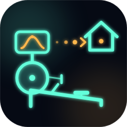
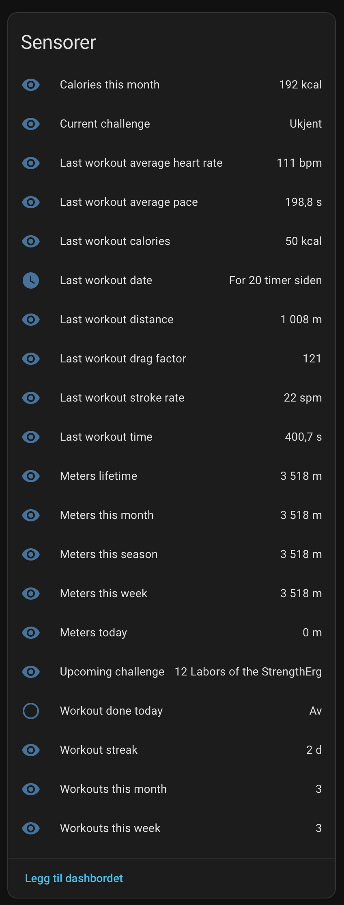

  

# Concept2 Logbook — Home Assistant Integration

Connects your [Concept2 Logbook](https://log.concept2.com) account to [Home Assistant](https://www.home-assistant.io)
over the official Concept2 API, and exposes your workout results as sensors and an
automation event. Read-only — it never writes anything back to your Concept2 account.

To install it, add this repository to HACS as a custom repository and paste a
personal access token from your Concept2 profile. See [Installation](#installation).

> [!NOTE]
> **AI-written.** [Claude Code](https://claude.com/claude-code) wrote this
> integration, and a person reviewed every change.
> The tests cover 99% of the lines, and CI is green.
> The author tested the main functions on one real Home Assistant instance and
> one real Concept2 account.
> No other people have tested it yet, and it is not in the HACS default store.
> [Open an issue](../../issues) if something stops working. The test details are in
> [concept2-ha-integration-design.md](concept2-ha-integration-design.md).

## What it does

- **Polls** the Concept2 API every 15 minutes and creates sensors for your results.
  You can change the interval to 10 minutes or more. See [Options](#options).
- **Fires** the event `concept2_new_result` for each new result. Use it as a trigger
  in an automation, for example for a notification or a light scene.
- **Syncs** the history of all your results once during setup, if you choose this.
  The lifetime totals are then correct from the first day.

The integration sends a `GET` request on a timer. Concept2 does not push data.
A new result therefore appears after at most 15 minutes. To get it at once, press
the **Sync now** button.

## Sensors

**Last workout:** distance, time, average pace, average heart rate, stroke rate,
calories, drag factor, date.

**Totals:** meters today, this week, this month, this season and lifetime.
Workouts this week and this month. Calories this month. Workout streak.

**Status:** the binary sensor "Workout done today".

**Challenges:** the current challenge and the upcoming challenge. These use public
Concept2 data and need no token. If Concept2 has no active challenge, "Current
challenge" shows "unknown". This is correct and is not an error.

**Diagnostic:** the sensor "Last synced" and the button "Sync now".
The button requests one sync and does not reload the integration.

## Options

To change the polling interval, go to **Settings → Devices & Services → Concept2
Logbook → Configure**. The minimum is 10 minutes. The limit protects the Concept2 API.

## Screenshot

The picture shows the sensors on a real instance, and the interface language is
Norwegian. The values come from a real Concept2 account.

## Dashboard

[`docs/example-dashboard.yaml`](docs/example-dashboard.yaml) is an example dashboard.
It shows totals, the last workout, challenges and the sync controls.
It uses only standard Home Assistant cards.
It does not copy the live display of the PM5, because the data is not live.

1. In a dashboard, select **⋮ → Edit Dashboard → ⋮ → Raw configuration editor**.
2. Paste the file as a new view and select **Save**.

Expected result: the dashboard shows the sensors with real values.

## What it does not do

- **It does not show live data.** It reads results after they reach Concept2 Logbook.
  It does not connect to the PM5 over Bluetooth. For live data, use a PM5 integration
  for Bluetooth.
- **It does not write to your account.** The integration contains no code that
  creates, changes or deletes data at Concept2.

## Requirements

- A Concept2 Logbook account.
- A personal access token. Create it at **log.concept2.com → Profile → Edit Profile
  → Applications → Concept2 Logbook API**. The token stays valid until you revoke it
  on the same page. You do not register an app and you do not need a client secret.
- [HACS](https://hacs.xyz), or the manual installation below.

## Installation

The integration is not in the HACS default store. Add it as a custom repository.

1. In Home Assistant, open **HACS**.
2. Select **⋮ → Custom repositories**.
3. Enter `https://github.com/kennethnilssen/hacs-concept2-logbook` and select the
   category **Integration**.
4. Find **Concept2 Logbook** in HACS and select **Download**.
5. Restart Home Assistant.
6. Select the button below, or go to **Settings → Devices & Services → Add Integration**
   and select **Concept2 Logbook**.

   

   The button works only after step 5, because the integration must be installed first.
   It works with the manual installation too and does not need HACS.
7. Paste your personal access token and continue.
8. Choose whether to sync the full history of your results now.
   If you choose yes, the first setup is slower and the lifetime totals are correct at
   once. If you choose no, the totals start from today.

Expected result: the device **Concept2 Logbook** appears with its sensors.

### Manual installation

1. Copy `custom_components/concept2_logbook` to the `custom_components/` folder in
   your Home Assistant configuration.
2. Restart Home Assistant.
3. Continue from step 6 above.

### Revoke access

1. Revoke the token at **log.concept2.com → Profile → Edit Profile → Applications**.
2. Wait for the next poll, or press **Sync now**.

Expected result: Home Assistant asks you for a new token. Paste a new token to
continue.

## Troubleshooting

| Problem | Cause | Action |
| --- | --- | --- |
| HACS does not show a new version | HACS keeps old data for the repository | Select **HACS → Concept2 Logbook → ⋮ → Redownload**. |
| Home Assistant asks for a new token | The token is revoked or invalid | Create a new token and paste it. |
| "Current challenge" is "unknown" | Concept2 has no active challenge | None. |
| A new result does not appear | The next poll is not yet done | Press **Sync now**. |

## Known limits

- A result that you delete at Concept2 stays in Home Assistant for up to 24 hours.
  Concept2 does not send a list of deleted results.
- The integration treats the date of a result as the local time zone of Home Assistant.
  The Concept2 API does not give a reliable time zone.

## Security

- The integration uses a personal access token that you create and can revoke.
- The integration sends only `GET` requests and requests no write scope.
- The integration does not store or log the token outside the Home Assistant config entry.
- **Limit:** the integration cannot read or restrict the scope of your token.
  Concept2 sets the scope when you create the token.

See [SECURITY.md](SECURITY.md) for the threat model and the OWASP mapping.

## Why this exists

I row at home on a Concept2 rowing machine, and I run my home on Home Assistant.
My training results lived in one place and my home lived in another.

This integration connects the two. In my home, a button in the training room starts a
scene and speaks the distance of my previous result.

I built it as a personal, read-only project, and I share it as it is. Claude Code wrote
the code. I set the rules, reviewed every change and tested it on my own account.
The full story is in [docs/STORY.md](docs/STORY.md).

## Attribution

Built with [Claude Code](https://claude.com/claude-code), human-reviewed,
security-focused. See [CLAUDE.md](CLAUDE.md) for the working agreement and
[concept2-ha-integration-design.md](concept2-ha-integration-design.md) for the design.
See [CHANGELOG.md](CHANGELOG.md) for the changes and
[docs/DEVELOPMENT.md](docs/DEVELOPMENT.md) for the setup and the release process.
Read [docs/STORY.md](docs/STORY.md) for the story of the project.

## Not affiliated

This project is not affiliated with or endorsed by Concept2 or by Nabu Casa (Home Assistant).
The icon is a generic drawing and does not copy a logo of either.

## License

MIT — see [LICENSE](LICENSE).
