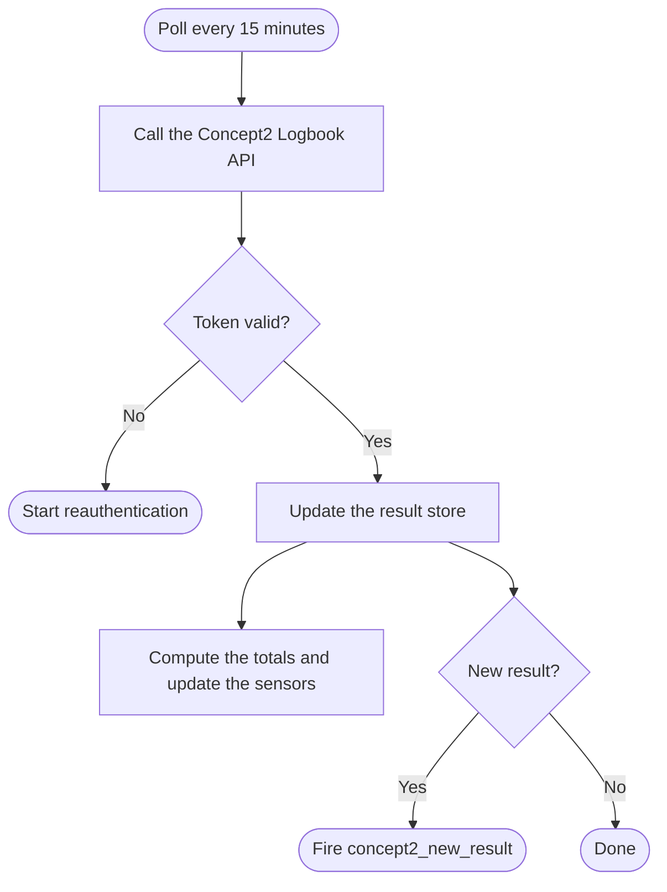
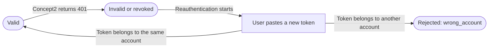

# Concept2 Logbook — design

**Integration domain:** `concept2_logbook`
**Display name:** Concept2 Logbook
**Tagline:** This integration connects Concept2 Logbook to Home Assistant over API using the official Concept2 API protocol.

This document describes the scope, the design and the test status of the integration.
The decisions have their reasons in section 5. The dated changes are in section 8.

## 1. Purpose and scope

The integration connects a Concept2 Logbook account to Home Assistant. It reads results
and challenges from the official Concept2 API and creates sensors and one event.

**Out of scope for version 1:**

- Live data from the PM5 over Bluetooth. Other integrations provide this.
- Webhooks from Concept2. The integration polls.
- Writing data to Concept2. The integration is read-only.
- More than one Concept2 account in one config entry. Add one config entry for each
  account.
- Installation from the HACS default store. See section 7.

## 2. Constraints

These constraints apply to every change. If a change breaks one of them, stop and report
it. `CLAUDE.md` holds the binding text.

| # | Constraint | Source |
| --- | --- | --- |
| C1 | The repository follows the HACS requirements. | hacs.xyz |
| C2 | The integration follows the Concept2 API documentation and terms. | log.concept2.com/developers/documentation |
| C3 | The authentication is self-service and the user can revoke it at any time. The integration uses a personal access token. | Concept2 API documentation, OWASP |
| C4 | The code is reviewable and states that Claude Code wrote it. The OWASP mapping in `SECURITY.md` stays true. | OWASP Top 10 |

## 3. Functions

| # | Function |
| --- | --- |
| F1 | A config flow in the Home Assistant interface, where the user pastes a personal access token. |
| F2 | The coordinator polls the results every 15 minutes with the filter `updated_after`. |
| F3 | The sensors, listed in the [README](README.md#sensors). The totals are computed locally, because the API gives no totals. |
| F4 | The event `concept2_new_result` for each new result. The first sync does not fire it. |
| F5 | The reauthentication flow when the token is revoked or invalid. |
| F6 | An options flow for the polling interval. The minimum is 10 minutes. |

The sensor "Last synced" and the button "Sync now" are diagnostic entities. The button
calls `async_request_refresh()` and does not reload the config entry.

The version supports the RowErg, the SkiErg and the BikeErg. The average pace is per
500 m, and per 1000 m for the BikeErg.

## 4. Design

### 4.1 Data flow

The diagram shows one poll. The coordinator keeps all results in a local store, and all
totals come from this store.

If the API answers with 429 or 5xx, the coordinator waits before the next call. The wait
starts at 60 seconds, doubles after each failure and stops at 3600 seconds. A
`Retry-After` header replaces the computed wait.

### 4.2 Local result store

The coordinator saves each result with its identifier in a Home Assistant `Store` file for
the config entry. Each poll adds or changes results by identifier. A full poll every
24 hours removes the results that Concept2 has deleted. The sensors compute the totals
from the store and not from the last poll.

### 4.3 Token states

If the token is revoked, the next poll gets a 401 response and the user pastes a new token.

The config flow checks a new token with `GET /api/users/me`. It maps 401 to
`invalid_auth` and a network error to `cannot_connect`. The Concept2 user identifier is
the unique identifier of the config entry.

### 4.4 Files

The code is in `custom_components/concept2_logbook/`. `api.py` is the API client,
`coordinator.py` holds the poll and the store, and `sensor.py`, `binary_sensor.py` and
`button.py` create the entities. `config_flow.py` holds the setup, the reauthentication
and the options. `diagnostics.py` redacts the export. The tests are in `tests/`.

### 4.5 Security

`SECURITY.md` holds the threat model and the OWASP mapping.

## 5. Design decisions

These sections may use longer sentences, because the reasons need them.

**D1. The sensor list.** The sensors are those in the README. Personal bests and sensors for
each split are not part of version 1. *Reason:* the list covers what a dashboard and an
automation need. *Rejected:* more sensors before real use shows what is missing.

**D2. Domain and name.** The domain is `concept2_logbook` and the display name is
"Concept2 Logbook". *Reason:* the domain matches the display name. *Rejected:* `concept2`.

**D3. Licence.** The licence is MIT. *Reason:* MIT is permissive. *Rejected:* Apache-2.0.

**D4. Public repository.** The repository has been public since 2026-07-05. *Reason:* the
HACS validation checks files that a private repository does not serve. *Rejected:* stay
private until the manual tests.

**D5. A personal access token and not OAuth2.** The user creates a token at Concept2 and pastes
it. *Reason:* an individual user sees only the personal token on the profile page. The OAuth
client registration is the path for apps with many users. *Accepted trade-off:* Concept2 sets
the scope of the token, and the integration cannot read or restrict it. The integration
makes only `GET` requests, so it cannot write. *Rejected:* OAuth2 with Application Credentials.
It was built and replaced. If OAuth2 returns, send `scope=user:read,results:read` in every
token request, including a refresh. Concept2 gives write access when the scope is missing.

**D6. Version 1.0.0 with two open tests.** The integration got the tag `v1.0.0` on
2026-07-12 while two manual tests were open (the dashboard and the reauthentication with a
real revoked token). *Reason:* the event `concept2_new_result` and the main functions were
confirmed, and the two open tests carried low risk. Both tests passed the same day (`v1.0.1`
and `v1.0.2`). *Rejected:* wait for all tests.

**D7. The production API.** `API_BASE_URL` is the production address. *Reason:* the Concept2
documentation allows a client that only reads to use production. *Rejected:* the development
server, which holds a separate database. The base URL is a constant and the user cannot set
it.

**D8. Our own back-off.** The coordinator has its own back-off for 429 and 5xx. *Reason:* the
`DataUpdateCoordinator` class has no exponential back-off. *Rejected:* a fixed interval.

**D9. A local store for the totals.** See section 4.2. *Reason:* a total that is only added to
cannot follow a result that Concept2 edits or deletes. *Rejected:* totals in memory.

**D10. No webhooks.** *Reason:* a webhook needs a Home Assistant address that Concept2 can reach
from the internet, and this adds an attack surface. *Rejected:* a webhook in version 1.

**D11. A release for each change that users must see.** A documentation change that must show
as the latest release also gets a version. *Reason:* HACS and GitHub choose the latest release
from the tags, so a change without a tag stays hidden. HACS also cannot install an update
without a tag. *Rejected:* releases only for code changes, and updates from an untagged commit.

## 6. Verification

### Automated tests

`pytest` runs 57 tests with a mocked API. They cover the config flow, the reauthentication,
the first sync and the new-result event, back-off, pagination, edited and deleted results,
the diagnostics, the options flow and the redaction of the token. The coverage is 99%. CI
runs ruff, hassfest, the HACS validation, CodeQL and the tests.

### Manual tests on a real instance

The author ran these tests on one real Home Assistant instance and one real Concept2 account.

| Test | Result | Date |
| --- | --- | --- |
| Install through a HACS custom repository and add the integration | Passed | 2026-07-11 |
| Paste a personal access token and sync the history | Passed | 2026-07-11 |
| Row a result. The result and the event `concept2_new_result` appear | Passed | 2026-07-12 |
| An automation on the event sends a notification | Passed | 2026-07-12 |
| Paste `docs/example-dashboard.yaml` into a dashboard | Passed | 2026-07-12 |
| Revoke the token at Concept2. The reauthentication starts and a new token works | Passed | 2026-07-12 |

The first real test of the event found that it did not fire after a reload of the
integration. The fix is in `1.0.0` (see the [changelog](CHANGELOG.md)).

## 7. Open items

These items are not decided.

1. **The icon.** The icon in `brand/` is a placeholder. A final icon is in `assets/logo/`.
   The decision is to use it, and the wiring is not done.
2. **The tagline in the README.** The README opening sentence and the tagline above are not
   the same sentence. Decide if the tagline goes into the README.
3. **The HACS default store.** The integration is a custom repository. The submission to
   the default store waits. HACS needs a full release, a passing HACS action and a brand
   icon, and the review can take months.

## 8. Change log

| Date | Change |
| --- | --- |
| 2026-11-15 | Rewritten after `docs/WRITING-STANDARD.md`. The gate model and the old test lists are removed. The decisions D1 to D11 have reasons and rejected options. The text is compared with the code. |
| 2026-07-12 | The tests A04 and A06 passed. The decision D6 is closed. The GitHub description is shortened. |
| 2026-07-11 | The decision D5: a personal access token replaces OAuth2. |
| 2026-07-05 | The repository is public (D4). The base URL is the production address (D7). |
