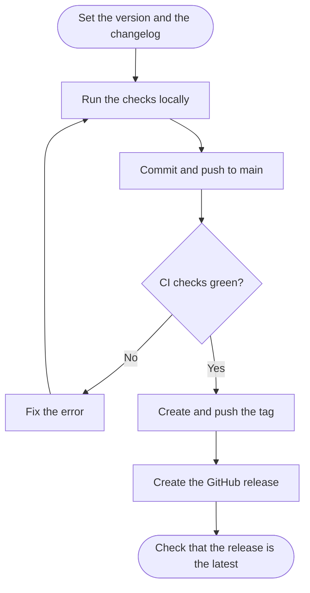

# Development guide

This guide describes how to set up the repository for work and how a release is made.

## Requirements

- **Python 3.14 or newer.** `pytest-homeassistant-custom-component==0.13.345` (pinned in
  `requirements_test.txt`) needs it. With an older Python, pip silently installs a broken
  older version of the package. Run `python3 --version` before you debug a test that
  makes no sense.
- **`gh` CLI**, signed in. Check with `gh auth status`. You use it for CI status and releases.
- **`git`.**

## First-time setup

1. Create the virtual environment. The option `--upgrade-deps` is needed, because a
   new environment can have no `pip` without it.

   ```bash
   python3 -m venv .venv --upgrade-deps
   source .venv/bin/activate
   pip install -r requirements_test.txt
   ```

   Expected result: `pytest --version` and `ruff --version` print a version.

## Run the checks

These commands are the same as in CI. All three must pass before you push.

```bash
source .venv/bin/activate
pytest tests --cov=custom_components.concept2_logbook
ruff check custom_components tests
ruff format --check custom_components tests
```

CI also runs hassfest and the HACS validation. These have no local equivalent.

## Change the code

1. Read `CLAUDE.md`. If a change breaks constraint C1 to C4, stop and report it.
2. For a change that is not small, write a plan and wait for approval.
3. Write the code and its tests together.
4. Run the checks.
5. Commit with a conventional-commit message (`feat:`, `fix:`, `docs:`, `test:`, `ci:`,
   `chore:`).

## Make a release

A release is made for each change that users must see. This includes a documentation
change that must show as the latest release.

The diagram shows the order of the steps. The tag comes only after the CI checks pass.



1. Set `version` in `custom_components/concept2_logbook/manifest.json`.
2. Add an entry under a new version heading in `CHANGELOG.md`, below `[Unreleased]`.
3. Run the checks.
4. Commit and push to `main`.
5. Wait until the five CI checks are green. Do not tag a commit before this.

   ```bash
   gh run list --repo kennethnilssen/hacs-concept2-logbook --limit 6
   ```

   Expected result: `Test`, `Lint`, `Hassfest`, `HACS validation` and `CodeQL` show
   `completed success` for the commit. `CodeQL` starts a little later than the others.

6. Create an annotated tag and push it.

   ```bash
   git tag -a vX.Y.Z -F <file with the tag message>
   git push origin vX.Y.Z
   ```

7. Create the GitHub release. Add `--prerelease` only for a real pre-release.

   ```bash
   gh release create vX.Y.Z --repo kennethnilssen/hacs-concept2-logbook \
     --title "..." --notes-file <file with the release notes>
   ```

8. Check that the release is the latest.

   ```bash
   gh api repos/kennethnilssen/hacs-concept2-logbook/releases/latest --jq '.tag_name, .prerelease'
   ```

   Expected result: the new tag and `false`.

**CAUTION:** Write the commit message and the tag message in a file and use
`git commit -F <file>`. A message with an apostrophe breaks the heredoc form
`git commit -m "$(cat <<'EOF' ... EOF)"` in this shell.

## HACS does not show the new release

HACS can show an old version after a correct release. The reason is old repository data
in HACS, not an error in the repository.

1. Select **HACS → the integration → ⋮ → Redownload**.
2. Check the HACS settings for a GitHub API rate-limit warning.
3. Restart Home Assistant.

## Known problems

- **A new virtual environment has no `pip`.** Use `--upgrade-deps` (see First-time setup).
- **`ruff format` removes the parentheses in `except (A, B):`.** The text then looks like
  an old Python 2 error. Use only one exception type in the clause where possible.
- **HACS needs a tag to update.** Without a tag, HACS requests
  `archive/refs/heads/<commit>.zip`. GitHub returns 404 for this address, because it is for
  branch names.
- **Do not keep the state "this is the first run" in an attribute of the coordinator.**
  Home Assistant creates the coordinator again at each reload and restart, and the
  attribute resets. The event `concept2_new_result` did not fire after a reload for this
  reason. Take the state from the stored data (`_last_synced_at is None`).
- **Do not trust the documentation of an external API over its live answer.** Concept2
  sends the challenge endpoints with the content type `text/html` and sends `{}` when
  no challenge exists. The integration reads the body with `content_type=None` and
  treats `{}` as no data. Check a new endpoint with `curl` first.
- **Keep the message of the original exception.** When you wrap an error from the API client,
  add the cause to the new message. A message without the cause hid the real error in the
  first live test.
- **Test the scheduled poll and the reload separately.** A reload forces a fast poll, and
  this path can behave differently from the scheduled poll.
