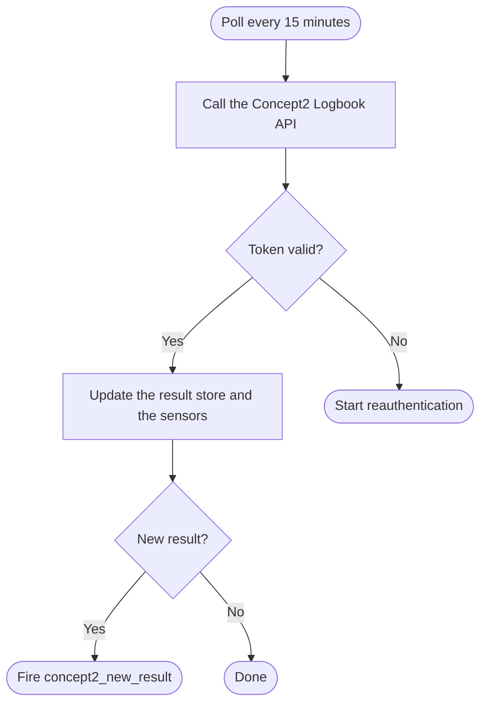

# Writing standard

This standard tells you how to write and update documents in this repository.
It applies to `README.md`, `SECURITY.md`, `CHANGELOG.md`, `docs/` and the design
document. It does not apply to code, code comments or the `strings.json` text.

The standard comes from the writing standard in the owner's `solution-design`
repository. This version keeps the language rules and the working method. It
leaves out the homelab template, because this repository is a software product
and not a homelab system.

**Rule zero:** Apply a rule only if it makes the document more useful to the
reader. Do not rewrite text that is already clear.

## 1. Binding limits for this task

These limits come from `CLAUDE.md`. They have priority over this standard.

1. Do not change constraints C1 to C4 in meaning. You can improve the wording.
2. Do not change the tagline in `CLAUDE.md` ("Technical conventions"). Do not change
   the meaning of the opening sentence of `README.md`. If the README opening and the
   tagline differ, report this to the owner. Do not fix it yourself.
3. Keep the "built with Claude Code, human-reviewed" attribution in `README.md`
   and `SECURITY.md`. Keep the licence text.
4. Do not change code, tests, workflows or `manifest.json`.
5. Show a plan first. Wait for approval. Work on the branch `docs/writing-standard`.
   Make small commits with conventional-commit messages (`docs:`). Open a pull
   request. The owner reviews each diff and merges.

## 2. Language rules (from ASD-STE100)

1. **Use one word for one meaning.** Use the names in section 3. Do not use
   synonyms to make the text more interesting.
2. **Keep sentences short.** Use a maximum of 20 words in a procedure and 25 words
   in a description.
3. **Write one instruction in each sentence.** Write one topic in each paragraph,
   with a maximum of six sentences.
4. **Use the imperative in procedures** ("Restart Home Assistant"). **Use the
   active voice in descriptions** ("The coordinator polls the API").
5. **Put the condition first.** "If the token is revoked, the integration asks
   for a new token."
6. **Do not use more than three nouns together.** Write "the history of the
   results", not "result history sync status".
7. **Use numbers, not vague words.** Write "every 15 minutes", not "often".
   Write dates as `YYYY-MM-DD`.
8. **Start a warning or a caution with the instruction, then give the reason.**
   - **WARNING:** risk of data loss, or of a security problem.
   - **CAUTION:** risk of a degraded integration or of extra work.
9. **Give the expected result** after each step that can fail.
10. **Do not use quotation marks, irony or slang for emphasis.** Use bold for a
    term the reader must not miss.

Rules 1 to 7 are less strict in the "Design decisions" parts of the design
document. A sentence there can be longer if the trade-off needs it. Code,
configuration and log output keep their original text.

## 3. Terms

Use the name in the first column. Do not use the names in the last column.
Check each term against the code and `strings.json` before you fix it here.

| Name | Use for | Do not use |
| --- | --- | --- |
| **Concept2 Logbook** | The online service at `log.concept2.com` | "the Logbook site", "Concept2 cloud" |
| **the integration** | This software | "the plugin", "the addon", "the component" |
| **Home Assistant** | The platform. Write "HA" only after the first full use in a document. | "Hass", "the hub" |
| **personal access token** | The credential the user creates at Concept2. Write "token" after the first use. | "API key", "password" |
| **result** | One workout entry in the Concept2 Logbook | "session", "activity", "workout" (as a noun for one entry) |

Keep "workout" where it is part of a sensor name or a coded label (for example
"Last workout" and "Workouts this week" in `strings.json`). Do not change those names.
| **sensor** | A Home Assistant sensor entity from the integration | "metric", "widget" |
| **config entry** | The stored setup of the integration in Home Assistant | "the config", "the account" |
| **season** | A Concept2 season, 1 May to 30 April | "year" |
| **stop** | A service that does not run, for any cause | "fail", "go down" |

Add a new name to this table when you use it in more than one document.

## 4. Document rules

### README.md

- The reader is a Home Assistant user. Put the answer to "What does this do and
  how do I install it?" before the badges and the notes.
- Do not add frontmatter. HACS renders this file.
- The "AI-written" note is correct and must stay. Shorten it to six sentences or
  fewer. Put the test details in `docs/` and link to them.
- Give each installation step one instruction and the expected result.
- Put known limits in a short list with a number or a condition in each item.

### Design document and `docs/*.md`

- Add this frontmatter to files in `docs/` and to the design document:

  ```yaml
  ---
  owner: kennethnilssen
  last-verified: YYYY-MM-DD
  ---
  ```

  `last-verified` is the date when a person last compared the document with the
  code or the running system. A language change alone does not change this date.
- Write each decision as: decision, reason, rejected alternatives.
- Keep only open questions in "Open decisions" or "Open items". Move a decided
  item to the decision text. Do not list normal maintenance (updates, version
  bumps) as an open item. Do not write an undecided item as if it was decided.
- Keep dated entries (for example "Amended 2026-07-11") in a change log at the
  end. Do not spread them through the text.
- Do not repeat what the code already says. Link to the file instead.

### CHANGELOG.md

Keep the Keep a Changelog format. Start each entry with what changed for the
user. Use the imperative or a short noun phrase. Do not retell the history.

### SECURITY.md

Keep the OWASP mapping true. Check each claim against the code. Update
`last-verified` only if you did this check.

## 5. Flow diagrams

Use Mermaid. GitHub renders it, and Git shows each change as text.

1. Show one flow in each diagram, with about 12 nodes at most.
2. Use `flowchart TD` for a sequence and `flowchart LR` for dependencies.
3. Use `([Start or end])`, `[Action or component]` and `{Decision?}`.
4. Write the condition on the arrow ("Yes" and "No", or the protocol and port).
5. Use the names from section 3 in the labels.
6. Write one sentence before the diagram that tells what it shows.

Add these diagrams where the text now only describes them:

| Where | Diagram |
| --- | --- |
| Design document, architecture | Data flow: Concept2 Logbook API, coordinator, local result store, sensors, event |
| Design document, authentication | Token states: valid, invalid or revoked, reauthentication |
| `docs/DEVELOPMENT.md`, releasing | The release steps with the CI check before the tag |

Example:



Check the polling interval against `const.py` before you use this example.

## 6. Suggested order of work

1. Read this file, `CLAUDE.md` and the design document.
2. Write a plan with the files, the changes and the order. Wait for approval.
3. Make the glossary pass: apply section 3 to all documents. Do not change meaning.
4. Make the language pass: apply section 2, starting with `README.md`.
5. Add frontmatter, the Mermaid diagrams and the open-items clean-up.
6. Do the checklist in section 7. Open a pull request.

## 7. Checklist before a pull request

- [ ] No binding limit in section 1 is broken. `git diff` shows no code change.
- [ ] The tagline, the attribution and the licence are unchanged.
- [ ] Each term follows section 3.
- [ ] Each procedure step has one instruction and, if it can fail, an expected result.
- [ ] Each warning and caution starts with the instruction.
- [ ] `docs/` files and the design document have the frontmatter, and the date is true.
- [ ] Each diagram follows section 5 and GitHub renders it.
- [ ] Only undecided items are in "Open decisions" or "Open items".
- [ ] No claim in `SECURITY.md` or the design document is new or unverified.
- [ ] CI is green: ruff, hassfest, HACS validation and pytest.
